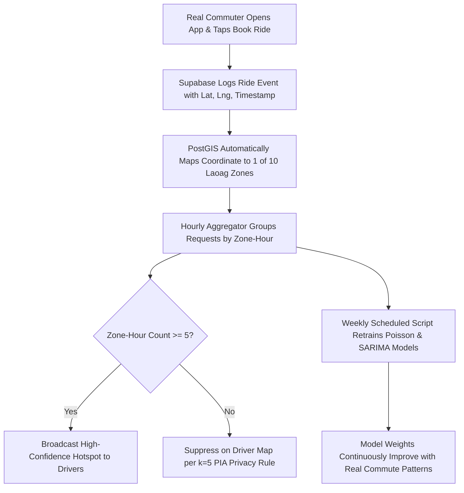

# PasadaNorte — Production Deployment, Transition & Go-Live Readiness Guide

> **Document Type:** Production Readiness Checklist & Deployment Runbook  
> **Target Date:** Next Month Launch  
> **Jurisdiction:** Laoag City, Ilocos Norte, Philippines  
> **Regulatory Standard:** Laoag City Ordinance No. 2023-005 & LTFRB MC 2025-10  
> **Technical Standards:** ISO/IEC 25010 (Software Quality) & ISO/IEC 19795-1 (Biometrics)

---

## 📑 Table of Contents
1. [Transitioning from Static Data to Real Passengers & Drivers](#1-transitioning-from-static-data-to-real-passengers--drivers)
2. [How the ML Demand Forecasting Adapts in Production](#2-how-the-ml-demand-forecasting-adapts-in-production)
3. [Pre-Deployment Master Checklist (Ready for Launch)](#3-pre-deployment-master-checklist-ready-for-launch)
   - [Phase 1: Database & Cloud Infrastructure (Supabase PostGIS)](#phase-1-database--cloud-infrastructure-supabase-postgis)
   - [Phase 2: Real Philippine SMS OTP Integration](#phase-2-real-philippine-sms-otp-integration)
   - [Phase 3: Backend API & AI Inference Deployment](#phase-3-backend-api--ai-inference-deployment)
   - [Phase 4: Mobile App Store Build & Release (`mobile_client`)](#phase-4-mobile-app-store-build--release-mobile_client)
   - [Phase 5: Web Admin Portal Hosting (`web_client`)](#phase-5-web-admin-portal-hosting-web_client)
   - [Phase 6: MINC (City Hall) & TODA Stakeholder Rollout](#phase-6-minc-city-hall--toda-stakeholder-rollout)
4. [Day-1 Go-Live Operational Runbook](#4-day-1-go-live-operational-runbook)
5. [Emergency Fail-Safe & Rollback Procedures](#5-emergency-fail-safe--rollback-procedures)

---

## 1. Transitioning from Static Data to Real Passengers & Drivers

### The "Cold-Start" Solution (Why Static Data Was Used)
When an app has zero users on Day 1, algorithms cannot forecast passenger volume. The **6,720 zone-hour dataset** and **4,565 trip logs** built into the prototype served as the **seed calibration model** representing authentic Laoag City paratransit rhythms between university gates, commercial complexes, and terminals.

### What Happens When You Remove Static Data?
1. **Pila Queues & Map:** The map will initially be clean. As registered tricycle drivers log in and flip their toggle to **Online**, their locations and TODA FIFO ranks appear in real time.
2. **GPS Accuracy:** Road routes and fares will be generated using live hardware GPS chips rather than simulated routes.
3. **Data Privacy ($k \ge 5$ PIA Rule):** If an hour has fewer than 5 real ride requests in a suburban zone (e.g., Z10 Gabu Airport), the map automatically keeps that zone suppressed to prevent de-anonymizing individual commuters.

---

## 2. How the ML Demand Forecasting Adapts in Production



### The Continuous Learning Cycle
* **Week 1 (Launch):** The model uses the calibrated baseline weights. Every ride booked is saved into `ride_requests`.
* **Week 2 to 4:** An automated weekly cron job runs `train_demand_forecast_model.py` on the real trip records.
* **Month 2 Onwards:** The system is 100% driven by real commuter habits, seasonal university schedules, market days, and rainfall patterns.

---

## 3. Pre-Deployment Master Checklist (Ready for Launch)

### Phase 1: Database & Cloud Infrastructure (Supabase PostGIS)
- [ ] **Purge Prototype Records:**
  Execute the database cleanup script in the Supabase SQL Editor:
  ```sql
  -- Remove all mock/test records while keeping the table structure intact
  TRUNCATE TABLE biometric_access_logs CASCADE;
  TRUNCATE TABLE encrypted_face_templates CASCADE;
  DELETE FROM users WHERE phone_number LIKE '%000%' OR phone_number LIKE '%123%';
  DELETE FROM zone_hourly_demand WHERE observation_date < CURRENT_DATE - INTERVAL '60 days';
  ```
- [ ] **Verify PostGIS Extensions & Indexes:**
  Ensure spatial queries are accelerated for Laoag City:
  ```sql
  CREATE INDEX IF NOT EXISTS idx_toda_terminals_center ON toda_terminals USING GIST (center_point);
  CREATE INDEX IF NOT EXISTS idx_zone_demand_centroid ON zone_hourly_demand USING GIST (zone_centroid);
  ```
- [ ] **Enable Row Level Security (RLS):**
  Ensure passengers can only see their own active trips, and drivers cannot access other drivers' earnings or passenger contact details.
- [ ] **Set Up Daily Automated Cloud Backups:**
  Turn on Supabase Automated Daily Backups and Point-in-Time Recovery (PITR).

---

### Phase 2: Real Philippine SMS OTP Integration *(Deferred: Post-MVP / Pre-Launch)*
> **Status:** ⏸️ **On Hold / Deferred to Pre-Launch Phase.**  
> During development and testing, the application utilizes the built-in test OTP simulator mode with 60-second cooldowns and 3-attempt lockout defense. Dedicated SMS provider onboarding will be executed right before public pilot release.

- [ ] **Select a Philippine Telco SMS Gateway:**
  - **Option A (Recommended Local):** [Semaphore.co](https://semaphore.co) (Fast delivery to Globe, SMART, DITO, TNT, TM via simple HTTP API).
  - **Option B (Enterprise):** [PhilSMS](https://philsms.com) or [Twilio](https://twilio.com).
- [ ] **Configure Supabase Auth Custom SMS Hook:**
  Add the SMS API key in `Supabase Dashboard` $\rightarrow$ `Authentication` $\rightarrow$ `Providers` $\rightarrow$ `Phone`.
- [ ] **Set Rate Limiting:**
  Configure a maximum of 3 OTP requests per phone number per 10 minutes to prevent SMS spam billing.
- [ ] **Whitelist Emergency Numbers:**
  Ensure Laoag City Central Terminal Dispatch and MINC Hotlines can log in without SMS delays.

---

### Phase 3: Backend API & AI Inference Deployment *(Selected Architecture: Option 1 — Deferred to Pre-Launch)*
> **Status:** ⏸️ **Decided & Deferred to Pre-Launch.**  
> **Chosen Architecture (Option 1):** Hybrid architecture keeping **Supabase Cloud (PostgreSQL + PostGIS + Storage + Realtime)** as primary engine, and deploying the lightweight **Python FastAPI (`backend/main.py`) microservice** to a **$0.00/month free-tier cloud container**.
> During development, FastAPI runs locally at `http://127.0.0.1:8000` while database/auth/storage runs live on Supabase Cloud (`https://zrkkbknndavvprejskjy.supabase.co`).

- [ ] **Select Free-Tier Cloud Container Host for FastAPI:**
  - **Choice A (Recommended for AI/ML):** [Hugging Face Spaces](https://huggingface.co/spaces) — **$0.00/mo**, 16 GB RAM, 2 vCPUs, native Docker support, no credit card required, permanent HTTPS endpoint.
  - **Choice B (Serverless Scale-to-Zero):** [Google Cloud Run](https://cloud.google.com/run) — **$0.00/mo** under Always Free Tier (2M requests/month free, up to 2GB RAM instances, scales to 0 when idle).
  - **Choice C:** [Render](https://render.com) or [Koyeb](https://koyeb.com) (Free 512MB RAM tier).
- [ ] **Deploy FastAPI Service (`backend/main.py`):**
  - **Docker / Python Environment:** Python 3.10+ with `fastapi`, `uvicorn`, `scikit-learn`, `supabase`, `pydantic`, `deepface`/`opencv`.
  - **Containerize:** Provide `Dockerfile` in `backend/` exposing port 8000.
- [ ] **Configure Production Environment Secrets:**
  ```env
  SUPABASE_URL=https://zrkkbknndavvprejskjy.supabase.co
  SUPABASE_SERVICE_ROLE_KEY=eyJh...
  API_SECRET_KEY=pasadanorte_prod_key_2026
  FAR_THRESHOLD=0.85
  ```
- [ ] **Update Client Endpoints in Flutter:**
  Point `mobile_client` and `web_client` AI service URL from `http://127.0.0.1:8000` to the deployed HTTPS container URL (e.g., `https://your-user-pasadanorte-api.hf.space`).
- [ ] **Restrict CORS:** Set `allow_origins` to your production Web Admin domain and mobile app origins.

---

### Phase 4: Mobile App Store Build & Release (`mobile_client`)
- [ ] **Create Production Android Keystore:**
  Generate the release signing key in PowerShell:
  ```powershell
  keytool -genkey -v -keystore c:\Users\MSI\Desktop\Flutter\PasadaNorte\mobile_client\android\upload-keystore.jks -keyalg RSA -keysize 2048 -validity 10000 -alias upload
  ```
- [ ] **Configure `android/key.properties`:**
  Store the keystore path and passwords securely (never commit to GitHub).
- [ ] **Update Package Name & Versioning:**
  In `mobile_client/pubspec.yaml`:
  ```yaml
  version: 1.0.0+1
  ```
- [ ] **Verify Required Android Permissions (`AndroidManifest.xml`):**
  - `ACCESS_FINE_LOCATION` & `ACCESS_COARSE_LOCATION` (GPS road navigation)
  - `CAMERA` (1:1 Face Verification & ID Upload)
  - `FOREGROUND_SERVICE_LOCATION` (Active trip tracking when screen is turned off)
  - `INTERNET` (Cloud communication)
- [ ] **Compile Android App Bundle (AAB):**
  ```powershell
  cd c:\Users\MSI\Desktop\Flutter\PasadaNorte\mobile_client
  flutter clean
  flutter pub get
  flutter build appbundle --release --no-tree-shake-icons
  ```
  The production file is generated at `mobile_client/build/app/outputs/bundle/release/app-release.aab`.
- [ ] **Google Play Console Submission:**
  Upload `.aab`, app screenshots, and privacy policy URL describing RA 10173 compliance.

---

### Phase 5: Web Admin Portal Hosting (`web_client`)
- [ ] **Compile Production Web Artifacts:**
  ```powershell
  cd c:\Users\MSI\Desktop\Flutter\PasadaNorte\web_client
  flutter clean
  flutter pub get
  flutter build web --release --no-tree-shake-icons
  ```
  The compiled production web bundle is created in `web_client/build/web/`.
- [ ] **Deploy to Production Web Hosting:**
  - **Option A (Zero-Cost & CDN Fast):** [Cloudflare Pages](https://pages.cloudflare.com) or [Vercel](https://vercel.com) (drag and drop `build/web`).
  - **Option B (Municipal Domain):** Upload to Laoag City LGU Server at `https://admin.pasadanorte.laoagcity.gov.ph`.
- [ ] **Verify Admin Login & Session Protection:**
  Ensure only authorized MINC Officers and TODA Presidents with authenticated email/password or admin phone credentials can access the dashboard.

---

### Phase 6: MINC (City Hall) & TODA Stakeholder Rollout
- [ ] **Import Authorized Tricycle Franchise Master List:**
  Gather the official Excel/CSV list of active **Motorized Tricycle Operator's Permits (MTOP)** from the Laoag City Tricycle Regulation Office (Body # `0001` to `#2500`).
- [ ] **Driver Onboarding & Biometric Verification Week:**
  1. Set up a physical verification booth at Laoag Central Terminal.
  2. Assist drivers in downloading the app.
  3. Upload their driver's license and take their baseline selfie.
  4. MINC admins approve the cards in the **Web Admin Portal**.
- [ ] **TODA Terminal Standees & Signage:**
  Install laminated QR code signs at the main terminals:
  - *Laoag Public Market & Commercial Complex TODA*
  - *MMSU Laoag Campus (Gate 2 / CTE)*
  - *Robinsons Place Ilocos Boundary TODA*
  - *Laoag City General Hospital (LCGH) TODA*
  - *Partas Bus Terminal TODA*
- [ ] **Student & Senior Citizen Information Campaign:**
  Distribute flyers at MMSU, NWU, and City Hall informing commuters that they receive the 20% statutory discount under Ordinance 2023-005 by scanning their student or OSCA/PWD ID once.

---

## 4. Day-1 Go-Live Operational Runbook

```
┌─────────────────────────────────────────────────────────────┐
│                 DAY 1 GO-LIVE SCHEDULE                      │
├─────────────┬───────────────────────────────────────────────┤
│ 05:00 AM    │ Supabase database check & PostGIS verification │
│ 05:30 AM    │ Web Admin Portal live at MINC Office          │
│ 06:00 AM    │ First wave of TODA drivers go ONLINE          │
│ 07:00 AM    │ Morning school rush: Monitor Z01 & Z02 demand │
│ 12:00 PM    │ Midday Fare Compliance audit check            │
│ 05:00 PM    │ University dismissal rush: Check queue dwell  │
│ 08:00 PM    │ Review Day 1 trips & export training dataset  │
└─────────────┴───────────────────────────────────────────────┘
```

---

## 5. Emergency Fail-Safe & Rollback Procedures

### Scenario A: Sudden Mobile Internet Drop in Outer Barangays
* **Engineered Fail-Safe:** The app includes local caching (`offline_queue_state.json`). 
* If a driver loses connection between Laoag and San Nicolas or Gabu, their TODA queue position and active trip fare calculation continue running locally using GPS satellite data. The record automatically syncs to Supabase as soon as 4G/LTE reconnects.

### Scenario B: Road Closures (Fiesta / Procession along J.P. Rizal St.)
* Open the **Web Admin Portal** $\rightarrow$ **TODA Stations**.
* Adjust the geofence radius or temporarily route bookings to the secondary arterial (Gen. Antonio Luna St.).

### Scenario C: Commuter Overcharging Report
* Go to **Web Admin Portal** $\rightarrow$ **Live Dispatch Audit**.
* Filter by **"Overcharged"**.
* Click **"Issue MINC Notice ➔"** to generate the formal summons with the exact trip distance and fare discrepancy.

---

## 6. Official Fare Formula Quick Reference (Laoag City Ord. 2023-005)

$$\text{Regular Upfront Fare} = ₱20.00 + \max\left(0, \text{Distance (km)} - 1.0\right) \times ₱5.00$$

$$\text{Discounted Fare (Student / Senior / PWD)} = ₱16.00 + \max\left(0, \text{Distance (km)} - 1.0\right) \times ₱4.00$$

*(All discounts are 20% statutory shares under RA 11314 and RA 9994).*

---

*Keep this guide accessible for your deployment milestone next month.*
